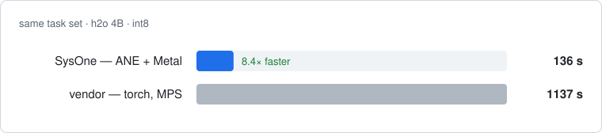

English | [简体中文](README.zh.md)

# SysOne

A fast, local decision inference engine. System-1 speed for edge AI.

SysOne takes a structured state (a JSON object or a piece of text) plus a set of
questions and options, and returns a probability for every option.

## Why SysOne

- **Both compute units at once.** The Neural Engine (ANE) runs the projection
  and FFN layers while the GPU runs attention and the state update; the two
  overlap instead of taking turns, which makes the same model at least 2.5×
  faster than a GPU-only path.
- **Memory that does not follow the model.** h2o's weights are 9.3 GB on disk
  and the service settles at about 0.6 GB, because only the resident layer
  window lives on the ANE; a conventional engine keeps every weight resident.
- **Same weights, one eighth of the time.** On the same task set h2o answers in
  136 s; the vendor's own torch engine needs 1137 s on the same machine with the
  same int8 weights.



## Requirements

- Apple Silicon (M1 or newer) on macOS 14 or newer.
- 8 GB of memory or more. The weights are memory-mapped, and only the resident
  layer window (`--W`, four layers by default) is held on the ANE; `--W 0` keeps
  all 32 layers resident and needs about 4.5 GB.
- arm64 Python 3.11 or newer.
- Xcode Command Line Tools (`xcode-select --install`) for `clang`.
- Disk: about 4 GB of weights for mude, 9.1 GB for d3, 9.3 GB for h2o and
  10.4 GB for torchcast (one model at a time), plus about 4 GiB of compiled
  artifacts. The weights are downloaded on first use.

## Install

```sh
git clone https://github.com/JuLian1130/SysOne.git sysone
cd sysone

python3 -m venv .venv
source .venv/bin/activate
python -m pip install --upgrade pip
pip install -e ./src
```

## Build the native libraries

`serve` needs three native libraries, which the repository does not ship. Run
this once per checkout; the first `serve` will not start without it:

```sh
tools/build_ane.sh
```

## Start the service

```sh
sysone serve --model h2o
```

The first start downloads the weights and compiles the ANE programs, then prints
`sysone serve: ready in ...s`; later starts report `compile 0.00s`. Running it
again is safe.

For mude use `--model mude`. d3 and torchcast download their sharded packages
on first use as well: `--model d3` runs `vllm-sr/d3-mini` on the split chain and
`--model torchcast` runs `torchcast-ai/torchcast-decision-4b` on the pooled
chain. Both only support the full-bidirectional mask, so they share no prompt
prefix between questions, though batching still applies. Give `--model`
explicitly for those two (their packages carry the same required files as
mude's). The vendor extra (`pip install -e './src[vendor]'`) is only needed to
run the vendor's own torch engine as a comparison baseline.

Check it from another shell:

```sh
curl -s http://127.0.0.1:8000/health
curl -s -X POST http://127.0.0.1:8000/v1/systemone \
  -H 'Content-Type: application/json' \
  -d @examples/request-service.json
```

Routes, status codes and request/response shapes: [API.md](API.md).

### Options

`sysone serve` takes the shared model flags plus the HTTP ones; every flag is
optional.

| Flag | Default / values | Meaning |
|---|---|---|
| `--model {d3,h2o,mude,torchcast}` | from `--backend` or `--weights` | model family |
| `--backend {split,pooled,vendor,reference}` | `pooled` for h2o and torchcast, `split` for mude and d3 | execution path; `vendor` runs a vendor's own engine, `reference` is the test-only semantic judge |
| `--weights PATH` | auto-download | explicit package; read-only, never downloads |
| `--offline` | off | never touch the network |
| `--quant {int8,fp16}` | `int8` | ANE weight storage; compute stays fp16 either way |
| `--attention-mode {causal,noncausal_full,prefix_noncausal}` | family default (`causal` for h2o, `prefix_noncausal` for mude, `noncausal_full` for torchcast and d3) | mask; a request can override it |
| `--bucket N` | `1024` | ANE program column width |
| `--width N` | `16384` | GPU buffer width, also the max input tokens |
| `--W N` | `4` | resident layers; `0` keeps all of them |
| `--batch N` | `4` | requests packed into one pass; `1` turns batching off |
| `--artifacts PATH` | platform cache | compiled artifact root |
| `--descriptor PATH` | — | semantic-judge descriptor (`--backend reference` only) |
| `--debug-timings` | off | add per-stage timings to each answer |

Vision (only for models with a tower):

| Flag | Default / values | Meaning |
|---|---|---|
| `--vision {auto,off}` | `auto` | `off` serves text only; image requests get `422` |
| `--vision-idle S` | `60` | seconds before the tower is unloaded; `0` unloads after every request |
| `--vision-bucket N` | chain bucket | tower tile width; must be a multiple of 4 |

HTTP:

| Flag | Default | Meaning |
|---|---|---|
| `--host HOST` | `127.0.0.1` | bind address |
| `--port N` | `8000` | bind port; `0` picks a free one |
| `--queue N` | `8` | admission waiting slots |
| `--admit-timeout S` | `120` | seconds a request may wait before `429` |
| `--name NAME` | model id | `model` field in responses |

Environment overrides: `SYS1_LOG_LEVEL` (default `info`), `SYS1_WEIGHTS_DIR`,
`SYS1_ARTIFACTS_DIR`, `SYS1_E8_DIR`, and `DECISION_API_KEY`; the matching flags
win over the variables.

## Troubleshooting

- `NotReadyError: 找不到 libe8ane.dylib` — run `tools/build_ane.sh`; check
  `SYS1_E8_DIR`. If `clang` is missing, run `xcode-select --install`.
- `ModuleNotFoundError: tokenizers` (or `jinja2`/`numpy`/`huggingface_hub`) —
  reinstall the package in the active venv: `pip install -e ./src`.
- A `download` error with `--offline` — drop `--offline` to let the first run
  fetch the weights; run the printed `hf download …` command and start with
  `--weights <that directory>`; or copy a finished package (including its
  `source.json`) under `SYS1_WEIGHTS_DIR`.
- `权重文件不存在` from an explicit `--weights` — the directory must be the
  published layout: a single `model.safetensors`, or a row-int8 directory with
  `int8_manifest.json`. Do not use `qybaihe/mude-1.0-mlx-8bit`: its MLX q8
  shards are not readable by the ANE chain.
- `422` with `prompt 超过链的缓冲宽度` — raise `--width` (and `--bucket` if
  needed), or shorten the prompt.
- Out-of-memory or a wired-memory warning — lower `--width`, and check that no
  other large model is resident.
- `503` from the service — the engine is still loading (the first start also
  downloads the weights and compiles), or loading failed; read the process log
  and `/metrics`.
- `429` — raise `--queue`/`--admit-timeout` or retry after `Retry-After`.
- h2o fails at `Serve.open` — `serve_config.json` or `h2o_lightning_shim.py` is
  missing; delete the cached package and let the next start re-download it.
