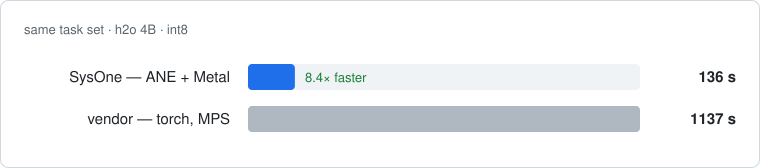

[English](README.md) | 简体中文

# SysOne

一个快速、本地的决策推理引擎。为边缘 AI 提供 System-1 级别的速度。

SysOne 接收一个结构化状态（JSON 对象或一段文本）加一组问题与选项，为每个选项返回一个
概率。

## 为什么用 SysOne

- **两颗芯片同时在算。** 投影与 FFN 跑在神经网络引擎（ANE）上，注意力与状态更新跑在
  GPU 上，两边重叠而不是轮流；同一个模型因此比纯 GPU 路径至少快 2.5 倍。
- **内存不跟着模型涨。** h2o 的权重在磁盘上是 9.3 GB，跑起来只占约 0.6 GB：ANE 上只
  驻留待命的层窗口，传统推理引擎则把整份权重常驻。
- **同一个模型，八分之一的时间。** 同一套题上，h2o 答完是 136 秒；同一台机器、同一份
  int8 权重，厂商自己的 torch 引擎要 1137 秒。



## 环境要求

- Apple Silicon（M1 或更新），macOS 14 或更新。
- 8 GB 或更多内存。权重按需 mmap，ANE 上只驻留待命的层窗口（`--W`，默认 4 层）；
  `--W 0` 把 32 层全部常驻，约需 4.5 GB。
- arm64 Python 3.11 或更新。
- Xcode Command Line Tools（`xcode-select --install`），`clang` 需要它。
- 磁盘：mude 权重约 4 GB，6 个 4B 检查点（d3 / h2o / pplx12 / pplx13 / singvl /
  torchcast）各约 9.1–10.4 GB（一次装一个模型），另加约 4 GiB 编译产物。权重在首次
  使用时下载。

## 安装

```sh
git clone https://github.com/JuLian1130/SysOne.git sysone
cd sysone

python3 -m venv .venv
source .venv/bin/activate
python -m pip install --upgrade pip
pip install -e ./src
```

## 构建原生库

`serve` 需要三份原生库，仓库不附带。每个 checkout 只跑一次；不跑的话第一次 `serve`
起不来：

```sh
tools/build_ane.sh
```

## 启动服务

```sh
sysone serve --model h2o
```

首次启动会下载权重并编译 ANE program，完成后打印 `sysone serve: ready in ...s`；之后
再启动报 `compile 0.00s`。随时可以重跑，不会重复做已完成的事。

mude 用 `--model mude`。d3 与 torchcast 的分片包同样在首次使用时下载：`--model d3`
跑 `vllm-sr/d3-mini`（split 链），`--model torchcast` 跑
`torchcast-ai/torchcast-decision-4b`（pooled 链）。两者都只支持全双向掩码，所以题与
题之间不共享前缀，但合批仍然可用。这两个家族要显式给 `--model`（发布包的必需件与
mude 相同）。d3 也收图（发布包自带视觉塔）。vendor 附加依赖（`pip install -e './src[vendor]'`）只在要把厂商自己的
torch 引擎当对拍基线时才会用到。

pplx-decider-flash 是两份独立的检查点（`--model pplx12` 与 `--model pplx13`）：v1.2
的读出打在用户轮里的 `<|fim_suffix|>` 标记上，v1.3 把 context 与一道题分块、读出在这条
序列末尾的标记上。两者都走 split 链、只有全双向掩码、一题一条序列（同一请求的多题可以
挤进一个合批 pass）；图像已支持、放在正文之前；多题的 `isolated` 布局与 v1.3 的 locate
头暂不支持。

inclusionAI 的 SingVL S1 4B（`--model singvl`）与上面四个的差别在**答案码怎么读**：256
个两字母码是绑定 embedding 的行，所以链直接从权重分片里切那几行，不另读一张码表。题面也是
它自己的一套（`<|im_start|>user` + 固定指令 + `### Question:` / `### Options:`），不走
chat 模板；同样只有全双向掩码；图像走它发布包自带的那座塔。它的 `score` 收 2 到 10 档。
发布包里没有 license 文件 —— 这里不做任何再授权。

另开一个 shell 检查：

```sh
curl -s http://127.0.0.1:8000/health
curl -s -X POST http://127.0.0.1:8000/v1/systemone \
  -H 'Content-Type: application/json' \
  -d @examples/request-service.json
```

路由、状态码与请求/响应形状见 [API.zh.md](API.zh.md)。

### 参数

`sysone serve` 接收共用的模型参数与 HTTP 参数；所有参数都可选。

| 参数 | 默认 / 取值 | 含义 |
|---|---|---|
| `--model {d3,h2o,mude,pplx12,pplx13,singvl,torchcast}` | 由 `--backend` 或 `--weights` 推断 | 模型家族 |
| `--backend {split,pooled,vendor,reference}` | h2o 与 torchcast 用 `pooled`、mude / d3 / pplx12 / pplx13 / singvl 用 `split` | 执行路径；`vendor` 跑厂商自己的引擎，`reference` 是只用于测试的语义裁判 |
| `--weights PATH` | 自动下载 | 显式包；只读，永不下网 |
| `--offline` | 关 | 不碰网络 |
| `--quant {int8,fp16}` | `int8` | ANE 权重存储形态；计算始终 fp16 |
| `--attention-mode {causal,noncausal_full,prefix_noncausal}` | 家族默认（h2o `causal`、mude `prefix_noncausal`、torchcast / d3 / pplx12 / pplx13 / singvl `noncausal_full`） | 掩码；请求可覆盖 |
| `--bucket N` | `1024` | ANE program 列宽 |
| `--width N` | `32768` | GPU 缓冲宽度，也是最大输入 token 数 |
| `--W N` | `4` | 常驻层数；`0` = 全部常驻 |
| `--batch N` | `4` | 一个 pass 最多装几条请求；`1` 表示不攒批 |
| `--artifacts PATH` | 平台缓存 | 编译产物落点 |
| `--descriptor PATH` | — | 语义裁判的 descriptor（只配 `--backend reference`） |
| `--debug-timings` | 关 | 每个回包加分阶段耗时 |

视觉（仅带塔的模型）：

| 参数 | 默认 / 取值 | 含义 |
|---|---|---|
| `--vision {auto,off}` | `auto` | `off` 只做纯文本；带图请求回 `422` |
| `--vision-idle S` | `0` | 塔空闲多少秒后卸载；默认每个请求后立刻卸，闲时不吃内存；连着来一堆带图请求时可以给 `60` 之类让它留着 |
| `--vision-bucket N` | 随链的桶 | 塔的瓦片宽，必须是 4 的倍数 |

HTTP：

| 参数 | 默认 | 含义 |
|---|---|---|
| `--host HOST` | `127.0.0.1` | 监听地址 |
| `--port N` | `8000` | 监听端口；`0` 取随机空闲口 |
| `--queue N` | `8` | 准入等待位 |
| `--admit-timeout S` | `120` | 请求最多等多少秒，超过回 `429` |
| `--name NAME` | 模型 id | 回包里的 `model` 字段 |

环境变量覆盖：`SYS1_LOG_LEVEL`（默认 `info`）、`SYS1_WEIGHTS_DIR`、
`SYS1_ARTIFACTS_DIR`、`SYS1_E8_DIR`、`DECISION_API_KEY`；对应的命令行参数优先于变量。

## 故障排查

- `NotReadyError: 找不到 libe8ane.dylib`——跑 `tools/build_ane.sh`，检查
  `SYS1_E8_DIR`。缺 `clang` 就跑 `xcode-select --install`。
- `ModuleNotFoundError: tokenizers`（或 `jinja2`/`numpy`/`huggingface_hub`）——在当前
  venv 里重装：`pip install -e ./src`。
- 带 `--offline` 的 `download` 错误——去掉 `--offline` 让首次运行拉权重；或跑打印出来的
  `hf download …`，再用 `--weights <that directory>` 启动；或把下好的整包（含
  `source.json`）放到 `SYS1_WEIGHTS_DIR` 下。
- 显式 `--weights` 报 `权重文件不存在`——目录必须是发布布局：单文件 `model.safetensors`、
  带 `model.safetensors.index.json` 的分片包，或带 `int8_manifest.json` 的 row-int8 目录。
  不要用 `qybaihe/mude-1.0-mlx-8bit`：它的 MLX q8 分片 ANE 链读不了。
- 回 `422` 且提示 `prompt 超过链的缓冲宽度`——加大 `--width`（必要时也加 `--bucket`），
  或缩短 prompt。
- OOM 或 wired memory 警告——调低 `--width`，并确认没有别的大模型常驻。
- 服务回 `503`——引擎还在装载（首次启动还要下载权重并编译），或者装载失败；看进程日志
  与 `/metrics`。
- `429`——加大 `--queue`/`--admit-timeout`，或按 `Retry-After` 重试。
- h2o 在 `Serve.open` 处失败——缺 `serve_config.json` 或 `h2o_lightning_shim.py`；删掉
  缓存里的包，下次启动会重下。
